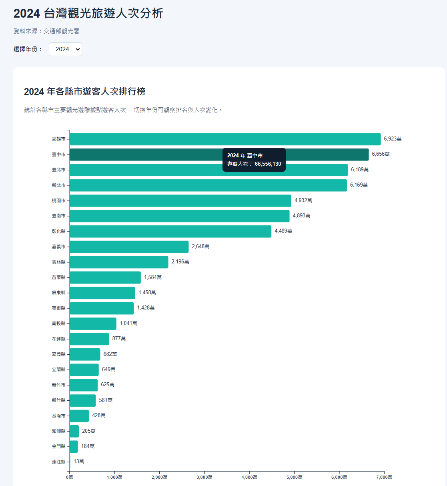
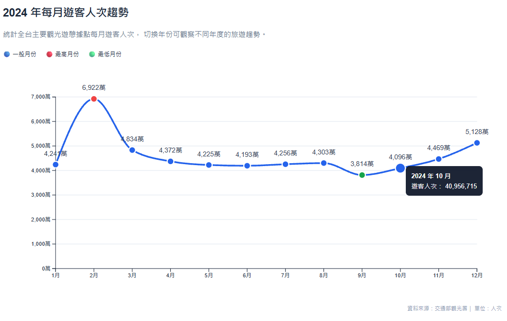

# 2024 年台灣觀光遊憩據點遊客人次視覺化分析

## 一、專案資訊

課程名稱：資料視覺化
作業名稱：HW2 - Static Visualization using D3.js
學號：414085052
姓名：黃浩祐
開發環境：** StackBlitz

# 台灣觀光旅遊人次動態視覺化

## 專案說明

本專案使用交通部觀光署的觀光旅遊資料，透過 **Vue 3、Vite 與 D3.js** 製作台灣觀光旅遊人次的動態資料視覺化。

本次作業將原本的靜態資料視覺化進一步改為動態視覺化，加入年份選擇、圖表動態更新、D3 Transition 與 Tooltip 等互動功能。

使用者可以選擇不同年份，觀察各縣市旅遊人次排名，以及每月旅遊人次的變化趨勢。

---

## 資料來源

資料來源：**交通部觀光署**

資料內容包含：

- 年份
- 縣市
- 觀光遊憩據點
- 每月遊客人次
- 年度遊客總人次

專案使用 `tourism.csv` 作為視覺化資料來源。

---

## 使用技術

- Vue 3
- Vite
- D3.js
- JavaScript
- HTML
- CSS

---

# 動態視覺化功能

## 1. 年份選擇

頁面提供年份下拉選單，使用者可以選擇不同年份。

當年份切換後，系統會重新篩選該年度的資料，並同步更新：

- 各縣市遊客人次排行榜
- 每月遊客人次趨勢
- 圖表標題

---

## 2. 各縣市遊客人次排行榜

使用 D3.js Bar Chart 呈現各縣市主要觀光遊憩據點的遊客人次。

各縣市依照遊客人次由高至低排列。

當使用者切換年份時：

- 長條圖資料會重新計算
- 排名會重新排列
- 長條長度會透過 D3 Transition 動態變化

將滑鼠移動至長條圖上時，會顯示 Tooltip，包含：

- 年份
- 縣市
- 遊客人次


---

## 3. 每月遊客人次趨勢

使用 D3.js Line Chart 呈現該年度 1 月至 12 月的旅遊人次變化。

當使用者切換年份時：

- 折線位置會重新計算
- 資料點會動態移動
- Y 軸刻度會根據資料重新調整
- 數值標籤會同步更新

透過 D3 Transition，使不同年度之間的資料變化可以平滑呈現。

圖表另外使用不同顏色標示：

- 🔵 一般月份
- 🔴 遊客人次最高月份
- 🟢 遊客人次最低月份

將滑鼠移動至資料點時，Tooltip 會顯示：

- 年份
- 月份
- 遊客人次


---

# 操作方式

1. 開啟專案頁面。
2. 在頁面上方找到「選擇年份」。
3. 使用下拉選單選擇想查看的年份。
4. 各縣市排行榜與每月趨勢圖會自動更新。
5. 將滑鼠移動至 Bar Chart 長條，可以查看該縣市的詳細遊客人次。
6. 將滑鼠移動至 Line Chart 資料點，可以查看該月份的詳細遊客人次。

---

# 動態視覺化流程

```text
選擇年份
    ↓
篩選該年度資料
    ↓
重新計算各縣市遊客人次
    ↓
重新計算每月遊客人次
    ↓
更新 Bar Chart
    ↓
更新 Line Chart
    ↓
D3 Transition 動畫呈現
```

---

# 專案結構

```text
.
├── public/
│   ├── tourism.csv
│   └── favicon.svg
│
├── src/
│   ├── assets/
│   │
│   ├── components/
│   │   ├── BarChart.vue
│   │   └── LineChart.vue
│   │
│   ├── App.vue
│   ├── main.js
│   └── style.css
│
├── index.html
├── package.json
├── package-lock.json
├── vite.config.js
└── README.md
```

---

# 執行方式

下載專案後，在 Terminal 進入專案資料夾。

安裝套件：

```bash
npm install
```

啟動開發環境：

```bash
npm run dev
```

接著使用瀏覽器開啟 Vite 顯示的 Local URL。

---

# 製作流程

1. 使用交通部觀光署資料作為資料來源。
2. 將資料整理為 CSV 格式。
3. 使用 D3.js 載入 `tourism.csv`。
4. 使用 Vue 管理使用者選擇的年份。
5. 根據所選年份篩選資料。
6. 使用 D3.js 計算各縣市遊客人次。
7. 使用 D3.js 計算 1 月至 12 月遊客人次。
8. 使用 Bar Chart 呈現各縣市旅遊人次排名。
9. 使用 Line Chart 呈現每月旅遊人次趨勢。
10. 加入年份選擇功能。
11. 加入 D3 Transition 動畫效果。
12. 加入 Tooltip 顯示詳細資訊。

---

# 本次作業重點

本次作業主要將原本的靜態視覺化改為動態視覺化。

新增的互動功能包括：

- 年份選擇
- 動態資料篩選
- Bar Chart 動態更新
- Line Chart 動態更新
- D3 Transition
- Tooltip
- 動態座標軸
- 動態排名

透過互動操作，使用者可以比較不同年份台灣觀光旅遊人次的變化，而不再只是觀看單一年度的靜態圖表。